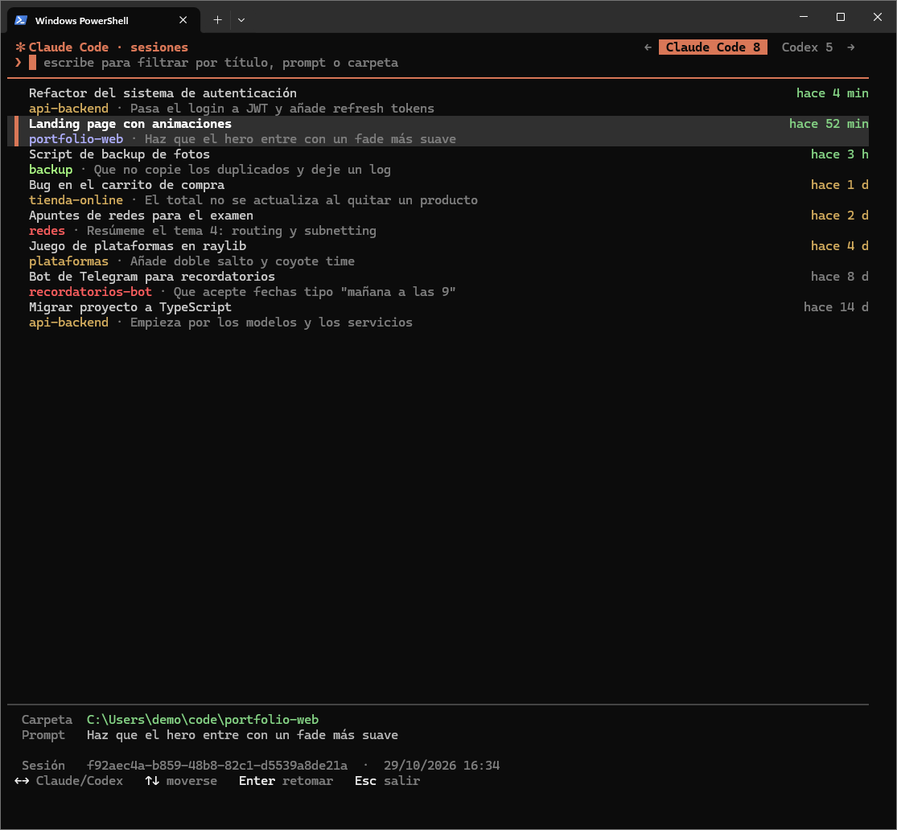
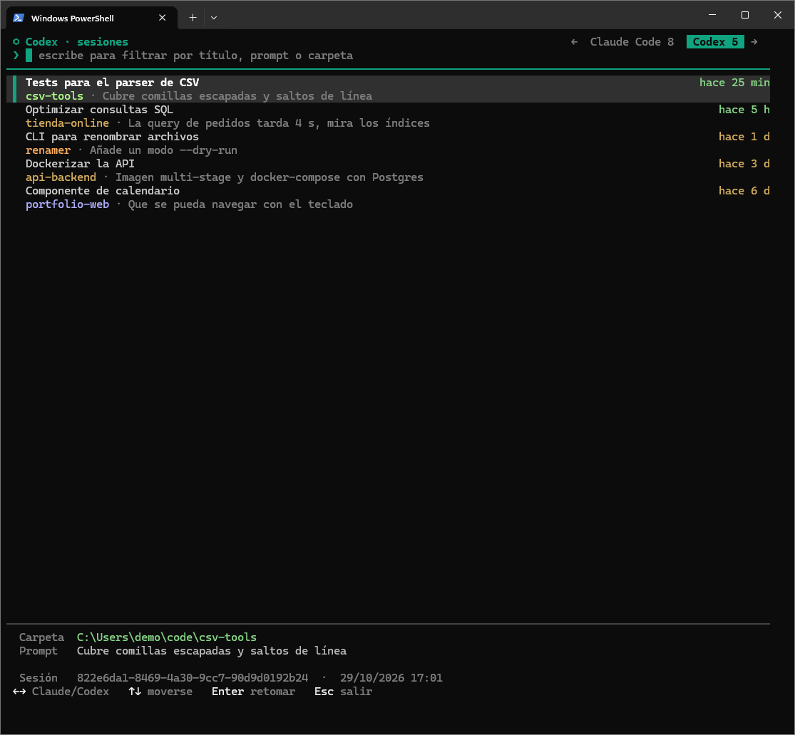

# ccr

**English** · [Español](README.es.md)

A session picker for **Claude Code** and **Codex** in PowerShell. It lists your conversations from every project, and when you pick one it jumps to that folder and resumes it.

No more trying to remember which folder you started that chat in just to run `/resume`.




## Features

- Claude Code and Codex sessions in two tabs (`←` / `→`).
- Title, last prompt, project folder and how long ago you used it.
- Instant search by title, prompt or path (multiple words = all must match).
- `Enter` changes to the project folder and runs `claude --resume <id>` or `codex resume <id>`.
- Fast: reads only the start and end of each transcript and keeps a cache, so only changed files are re-read.
- No dependencies: a single PowerShell script. Works on Windows PowerShell 5.1 and PowerShell 7.

> The interface is currently in Spanish.

## Install

```powershell
git clone https://github.com/<user>/ccr.git
cd ccr
.\install.ps1
```

Open a new terminal and type `ccr`.

`install.ps1` only adds this line to your `$PROFILE` (replacing it if it already exists):

```powershell
function ccr { & "C:\path\to\ccr\ccr.ps1" @args }
```

> If PowerShell refuses to run scripts: `Set-ExecutionPolicy -Scope CurrentUser RemoteSigned`

## Usage

```powershell
ccr              # open the picker
ccr backend      # open it already filtered
ccr -Refresh     # rebuild the cache from scratch
ccr -Demo        # fake data, for screenshots without showing your own chats
```

| Key | Action |
|---|---|
| type | filter |
| `←` `→` `Tab` | switch between Claude Code and Codex |
| `↑` `↓` `PgUp` `PgDn` `Home` `End` | move |
| `Enter` | go to the folder and resume the session |
| `Esc` | quit |

## Where the data comes from

| | Claude Code | Codex |
|---|---|---|
| Sessions | `~/.claude/projects/*/<id>.jsonl` | `~/.codex/sessions/YYYY/MM/DD/rollout-*-<id>.jsonl` |
| Folder | transcript `cwd` field | `session_meta.cwd` |
| Title | `custom-title` → `ai-title` → last prompt | `session_index.jsonl` → first message |
| Last prompt | `last-prompt` | `history.jsonl` → last user message |

`CLAUDE_CONFIG_DIR` and `CODEX_HOME` are respected if set. The cache lives in `%LOCALAPPDATA%\cc-sessions\`.

`ccr` is **read-only**: it never modifies or deletes your sessions.

## Caveat

It reads internal Claude Code and Codex file formats that are neither documented nor stable. If an update changes them, some sessions may stop showing up until the script is updated.

## Development

`ccr.ps1` must be saved as **UTF-8 with BOM**: Windows PowerShell 5.1 reads BOM-less scripts as ANSI, and characters like `→`, `─` or accented letters break parsing. The included `.editorconfig` sets this for editors that honor it.

## License

MIT
